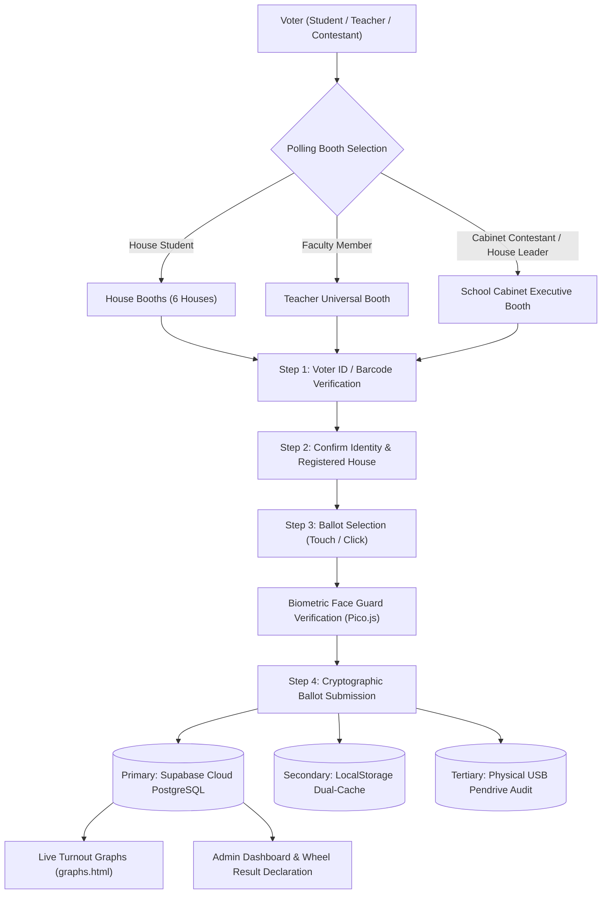

# SPR High School Elections 2026-27 — System Architecture & Technical Documentation

> **Project:** Official School House & Cabinet Elections 2026-27 (`Election Spr 2026`)  
> **Platform Version:** 5.4.0 Production Ready  
> **Total Voters:** 1,085 Registered Students · 87 Faculty & Staff · 24 House Captains · 39 Cabinet Contestants  
> **Constituencies:** Gangotri, Trimbakeshwar, Yamunotri, Manasarovar, Mahabaleshwar, Amarkantak  

---

## 1. System Overview & Architecture

The **SPR High School Election Platform** is a secure, high-concurrency, dual-redundant electronic voting system built specifically for school leadership elections. It runs entirely on modern web standards with client-side execution, backed by Supabase Cloud PostgreSQL and resilient offline local storage mechanisms.

### Core Architecture Pillars:
1. **Client-Side Kiosk Runtime:** Clean HTML5, CSS3, and vanilla JavaScript without heavy frontend frameworks, enabling zero-latency touch response even on low-power kiosk laptops.
2. **Cloud PostgreSQL Database (Supabase):** Handles live voter status updates, encrypted ballot logs, audit trails, and multi-booth synchronization across classrooms.
3. **Dual-Redundant Offline Mode:** If Wi-Fi or Cloudflare Tunnel drops, the system seamlessly continues operating via `localStorage` and background queue synchronization.
4. **Hardware Pendrive Backup (File System Access API):** Automatically writes timestamped JSON ballots and biometric verification photos directly to an attached USB flash drive.
5. **Real-Time Turnout Telemetry:** Fast, lightweight polling every 1.5 seconds delivers live voter participation counts to large overhead projection screens (`graphs.html`).

---

## 2. Polling Booth Structure & Workflows

### 2.1 The 6 House Polling Booths
Each of the 6 houses has its own isolated polling station enforcing voter constituency rules:
1. **Bheeshma House** (`/Houses/bheeshma/`) — *Gangotri Constituency* (Yellow/Gold `#eab308`)
2. **Gurudrona House** (`/Houses/gurudrona/`) — *Trimbakeshwar Constituency* (Blue `#2563eb`)
3. **Hanuman House** (`/Houses/hanuman/`) — *Yamunotri Constituency* (Orange `#f97316`)
4. **Karna House** (`/Houses/karna/`) — *Manasarovar Constituency* (Red `#ef4444`)
5. **Vasistha House** (`/Houses/vasistha/`) — *Mahabaleshwar Constituency* (Pink/Crimson `#ec4899`)
6. **Vishwamithra House** (`/Houses/vishwamithra/`) — *Amarkantak Constituency* (Purple `#8b5cf6`)

**Voted Positions per House (4 Roles):**
- Boys Captain (Class 10)
- Girls Captain (Class 10)
- Boys Vice Captain (Class 9)
- Girls Vice Captain (Class 9)

---

### 2.2 Teacher Universal Polling Booth (`/Houses/teachers/`)
- **Audience:** 87 Teaching Faculty & Administrative Staff.
- **Capability:** Single-session universal ballot allowing teachers to vote for **all 29 leadership positions simultaneously**:
  - 5 School Cabinet roles (President, Vice President, Sports Secretary, Literary Secretary, Social & Cultural Secretary).
  - 24 House roles across all 6 student houses (Captains and Vice Captains).
- **Authentication:** Teacher Employee ID (IDs `6001`–`6087` or universal demo accounts).
- **Interface:** Streamlined carousel step-through with progress tracking (`0 / 29 Selected`) and review summary.

---

### 2.3 School Cabinet Executive Booth (`/Houses/central/`)
- **Audience:** School Cabinet Contestants & the 24 Elected House Leaders (Electoral College).
- **Positions Voted (5 Executive Roles):**
  1. **School President** (Class 10)
  2. **School Vice President** (Class 9)
  3. **Sports Secretary** (Class 9)
  4. **Literary Secretary** (Class 9)
  5. **Social & Cultural Secretary** (Class 9)
- **Special Voter Verification Flow:**
  - **Step 1 (Voter ID Entry):** Accepts either the candidate's nomination admission number (e.g., `7083`, `10055`, `9K7051`) or their official student voter ID (e.g., `1C6305`, `1C3135`).
  - **Step 2 (House Identity Display):** **Prominently displays the student's Registered House and Constituency** (e.g., *"🏛️ Registered House: Vasistha House (Mahabaleshwar Constituency)"*) so voters clearly see their house affiliation before casting executive votes.
  - **Next Button:** Dedicated action button labeled **"Next: Vote into School Cabinet →"** leads directly into the 5-role ballot.
  - **Cross-Booth Voting Rights:** School Cabinet contestants are fully permitted to vote in their designated house booth for House Captains, as well as in the School Cabinet booth.

---

## 3. Biometric Edge Face Guard (`pico.js`)

Each polling booth integrates client-side biometric verification to ensure election integrity without transmitting raw video feeds over the network:
1. **Edge Cascade Evaluation:** When a voter presses "Cast Vote", an oval guide modal activates the webcam.
2. **Pico.js Face Detection:** Uses an optimized 24-stage cascade (`pico.js`) to confirm a human face is present, upright, and unobscured.
3. **Obstruction & Lighting Guard:** Analyzes luminance variance across the frame to prevent spoofing with pictures or physical obstruction of the camera lens.
4. **Auto-Capture Audit Proof:** A high-resolution JPEG snapshot is encoded into the ballot record and uploaded to Supabase Storage and USB drive for tamper-evident auditing.

---

## 4. Real-Time Turnout Graphs (`Houses/graphs.html`)

Designed for auditorium displays and administrative monitors:
- **Top 4 KPI Metrics:**
  - Total Voted / Total Eligible (`X / 1,085 Total (Y%)`)
  - Boys Turnout (`X / 534 Boys`)
  - Girls Turnout (`X / 550 Girls`)
  - Students Remaining to Vote
- **House-Wise Voter Turnout Comparison:**
  - 6 paired vertical bar columns displaying real-time Boys and Girls turnout per house.
  - Houses prominently labeled with their official name and constituency:
    - Bheeshma (*Gangotri*)
    - Gurudrona (*Trimbakeshwar*)
    - Hanuman (*Yamunotri*)
    - Karna (*Manasarovar*)
    - Vasistha (*Mahabaleshwar*)
    - Vishwamithra (*Amarkantak*)
- **Silent Background Live Sync:** Automatically checks for new accepted ballots every 1.5 seconds via Supabase REST API and cross-tab `BroadcastChannel`.

---

## 5. Security & Tamper-Prevention Mechanisms

1. **One-Student-One-Vote Enforcement:**
   - Double voting is strictly blocked at both client and database levels.
   - Separate ballot tracking ensures House Captains and Cabinet Contestants can vote in their House and in School Cabinet without triggering false duplicate blocks.
2. **Re-Authorization Workflow for Cancelled Ballots:**
   - If a student casts a mistaken ballot, Election Officers can authorize a supervised cancellation from the Admin Panel. The booth immediately updates the voter's status to *"Re-authorized After Cancellation"*, allowing one fresh vote.
3. **No-Plaintext Secrets:**
   - Supabase keys utilize restricted publishable tokens with Row-Level Security (RLS) policies.

---

## 6. Official Electoral Roster Summary

| Category | Registered Count | Voting Stations |
|---|---|---|
| **Class 6–10 Students** | 1,085 | 6 House Booths (`/Houses/<house>/`) |
| **Teaching Faculty & Staff** | 87 | Teacher Universal Booth (`/Houses/teachers/`) |
| **School Cabinet Contestants** | 39 | House Booth + School Cabinet (`/Houses/central/`) |
| **Elected House Captains** | 24 | School Cabinet (`/Houses/central/`) |
| **Total Candidates on Ballot** | 147 | Distributed across 29 elective offices |

---

*Document compiled and verified for the SPR High School Election Commission 2026-27.*
