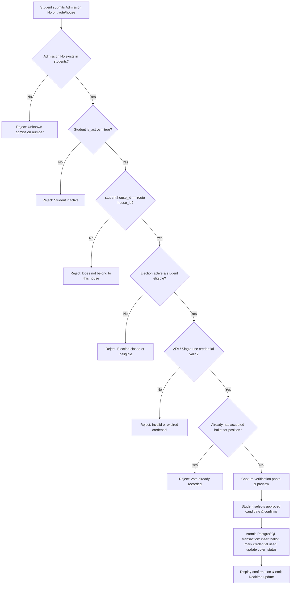

# School House Voting System — Project Plan & Architecture Specification

**Project Type:** School Election & House Voting Web Application  
**Version:** 1.1 (Updated after Session 1 MVP Implementation)  
**Ballot Model:** Identified Ballot (Authorized Administrator Visibility)  
**Original Target Stack:** Next.js (App Router), TypeScript, Tailwind CSS, Supabase, Vercel  
**Active MVP Stack (Session 1):** Self-Contained Static HTML/CSS/JS House Folders + Admin Console + House Turnout Graphs + Firebase Firestore Web SDK (`v13.2.0`) with `localStorage` fallback  
**Session 1 Progress, Issues & Pending Tracker:** See [SESSION_1_LOG.md](./SESSION_1_LOG.md)

---

## 1. Project Overview

The **School House Voting System** is a centralized web platform designed to run school house elections across six official houses. It unifies:

- A single validated **master student register** (where contesting candidates are linked directly to their student records rather than maintaining duplicate accounts).
- **Six house-specific voting routes** (`/vote/bishma`, `/vote/gurudrona`, `/vote/hanuman`, `/vote/karna`, `/vote/vasistha`, `/vote/vishwamithra`) backed by strict server- and database-level house eligibility enforcement.
- A **real-time voter register** and **candidate directory** showing each candidate's house, class, section, admission number, position, and photo, plus live voting status updates (`Voted` / `Not voted`).
- **Second-factor student verification** (OTP or single-use voting credential) and **camera-based verification photo capture** stored privately.
- An **identified-ballot administrative console** where the Principal and explicitly authorized teachers can monitor participation, inspect verification photos, view individual candidate selections, investigate suspected impersonation, cancel fraudulent or erroneous votes (without deleting records), and issue single-use replacement credentials so legitimate students can re-vote.

> [!IMPORTANT]
> **Identified-Ballot Policy Notice:** Because authorized administrators can view which candidate a student voted for alongside the student's identity and verification photo, this system is **not** a secret-ballot election. The school must formally approve this model, define access/retention rules, and inform students and guardians with appropriate notice and consent before collecting votes or photographs.

---

## 2. Core Objectives

1. Provide dedicated, colour-themed voting portals for all six school houses within one unified application.
2. Maintain one central, validated master student register imported from CSV/Excel.
3. Link candidate profiles directly to existing student records and enforce matching house membership.
4. Enforce house-based voting eligibility strictly on the server and in PostgreSQL—not just in frontend UI code.
5. Prevent duplicate/repeated voting per student, election, and position (across refreshes, multiple devices, or URL tampering).
6. Capture and securely store verification photographs in private storage with short-lived signed access for authorized staff.
7. Update the voter register and administrator dashboard automatically via Supabase Realtime.
8. Support full identified-ballot inspection for the Principal and explicitly authorized Election Administrators.
9. Provide a controlled, audited impersonation-investigation and soft-cancellation workflow with single-use replacement credentials.
10. Tally live and final results strictly from `accepted` ballots while permanently preserving `cancelled` ballots in history.
11. Gate student-facing results behind explicit Principal publication after election closure.
12. Maintain an immutable, append-only audit trail for all sensitive administrative and voting actions.

---

## 3. The Six Official Houses

All house names, codes, and colours are stored centrally in the `houses` database table so administrators can update branding or configuration without code changes.

| House Name | House Colour | House Code | Voting Route |
| :--- | :--- | :--- | :--- |
| **Bishma** | Yellow | `BISHMA` | `/vote/bishma` |
| **Gurudrona** | Blue | `GURUDRONA` | `/vote/gurudrona` |
| **Hanuman** | Orange | `HANUMAN` | `/vote/hanuman` |
| **Karna** | Red | `KARNA` | `/vote/karna` |
| **Vasistha** | Pink | `VASISTHA` | `/vote/vasistha` |
| **Vishwamithra** | Purple | `VISHWAMITHRA` | `/vote/vishwamithra` |

- Each student belongs to **one** registered house in the master student table.
- Students cannot select or switch their house during voting.
- **Theme-Only Colours:** House colours are applied strictly for visual UI theming (accents, glows, borders, buttons). Visible UI text must always use the official house names (`Bishma`, `Gurudrona`, `Hanuman`, `Karna`, `Vasistha`, `Vishwamithra`), never colour labels like `"Blue House"` or `"Yellow House"`.
- All six routes belong to the same Next.js dynamic route (`src/app/vote/[house]/page.tsx`), rendering the requested house's theme, colour, and approved candidates.

---

## 4. User Roles & Permissions

Every administrator must authenticate with an individual Supabase Auth account. Shared teacher credentials must never be used. Permissions are enforced in PostgreSQL via database-backed role assignments (`admin_users`) and Row Level Security (RLS), never trusted from client state.

| Capability / Permission | Student | Monitoring Admin | Election Admin | Principal |
| :--- | :---: | :---: | :---: | :---: |
| Cast vote in own registered house | Yes | No | No | No |
| View published final results | After publish | Yes | Yes | Yes |
| View admin dashboard & live totals | No | Yes | Yes | Yes |
| View student & voter registers | No | Assigned scope | Assigned scope | All |
| View verification photographs | No | If granted | If granted | Yes |
| View identified ballot choices | No | If granted | If granted | Yes |
| Manage / approve candidates | No | No | If granted | Yes |
| Import / manage student records | No | No | If granted | Yes |
| Flag suspected impersonation | No | No | Yes | Yes |
| Cancel accepted ballots (with reason) | No | No | If granted | Yes |
| Issue replacement credentials | No | No | If granted | Yes |
| Start, pause, or close elections | No | No | No | Yes |
| Publish results to students | No | No | No | Yes |
| Add / remove admin accounts & roles | No | No | No | Yes |
| View audit logs | No | No | Assigned scope | All |

---

## 5. Student Register & Candidate Directory

### 5.1 Master Student List

Students are bulk-imported from validated CSV/Excel sheets and checked for duplicate admission numbers, missing required fields, and invalid house names before activation.

| Field | Example | Purpose |
| :--- | :--- | :--- |
| `id` | `uuid` | Internal primary key |
| `admission_no` | `1009` | Unique school admission number |
| `full_name` | `Student A` | Student's full name |
| `class_name` | `10` | Grade / class |
| `section` | `A` | Class section |
| `house_id` | `HANUMAN` (FK) | Assigned official house |
| `is_active` | `true` | Controls active voting eligibility |

### 5.2 Candidates (Linked to Student Records)

A candidate is an existing student contesting an election position—**not** a separate admission-number account. A candidate who is a student votes using the exact same `admission_no` (`1009`) and is subject to the exact same house restriction and one-vote rules.

- **Required link:** `candidates.student_id -> students.id`
- **Consistency rule:** `candidates.house_id` must match the student's registered `students.house_id`.
- **Display rule:** Only records with `is_approved = true` appear on student voting portals.

**Example Candidate Directory View:**

- **Student A** — Admission: `1009` · Class `10-A` · **Hanuman House** · House Captain *(Photo)*
- **Student B** — Admission: `1015` · Class `10-B` · **Karna House** · House Captain *(Photo)*
- **Student C** — Admission: `1021` · Class `9-A` · **Bishma House** · Vice-Captain *(Photo)*

---

## 6. Strict House Verification & Voting Workflow

### 6.1 House-Mismatch Enforcement Example

Suppose **Student A** (`admission_no = 1009`, Class `10-A`, Registered House = **Hanuman**):

- Opens `/vote/hanuman`: **Eligible** — `Registered house (Hanuman) == Requested house (Hanuman)`. Student proceeds to second-factor verification, photo capture, and candidate selection.
- Opens `/vote/gurudrona`: **Access Denied** — `Registered house (Hanuman) != Requested house (Gurudrona)`. The server rejects the attempt with:
  > *"You do not belong to this house. Voting is permitted only in your registered house."*

### 6.2 Server-Side Verification Flow

Every check below runs on the server and inside database transactions so changing the URL, calling APIs directly, or tampering with browser state cannot bypass eligibility.



### 6.3 Multi-Position Tracking

When an election includes multiple positions (for example: **House Captain**, **Vice-Captain**, and **Sports Captain**), participation is tracked **per `(election_id, student_id, position_id)`**. A student who votes for House Captain is marked `voted` only for House Captain and remains eligible to complete Vice-Captain and Sports Captain without being prematurely blocked.

---

## 7. Camera Verification Photographs

1. **Permission & Consent:** The browser uses `navigator.mediaDevices.getUserMedia` (HTTPS required in production) and explicitly prompts for camera permission with clear notice of why the image is captured.
2. **Preview Before Submit:** The student sees the captured frame and confirms before upload.
3. **Private Storage:** Images are uploaded to a **private Supabase Storage bucket** (`verification-photos`), never publicly accessible.
4. **Controlled Access:** Only authorized administrators receive short-lived signed URLs to inspect verification images, and sensitive image views are logged.
5. **Safeguards:** Photos document camera capture during voting and assist manual review; they are not used for unapproved biometric/facial recognition, and a school-defined retention/deletion schedule applies post-election.

---

## 8. Repeated-Vote Prevention & Real-Time Register

### 8.1 Real-Time Voter Register

As soon as an atomic vote transaction succeeds, Supabase Realtime pushes the update to the administrator voter register (and any authorized kiosk/register view):

| Admission No | Student Name | Class | House | Status |
| :--- | :--- | :--- | :--- | :--- |
| `1009` | Student A | `10-A` | Hanuman | **Voted** |
| `1010` | Student B | `10-B` | Hanuman | **Not voted** |
| `1011` | Student C | `9-A` | Hanuman | **Voted** |

If Student A refreshes the page, opens another browser/device, or re-enters `1009`, the server immediately blocks the attempt:

> *"Vote already recorded. This admission number has already completed voting for this election position."*

### 8.2 Defense-in-Depth Anti-Duplicate Controls

- **Partial Unique Index on `ballots`:** Only **one** ballot with `status = 'accepted'` can exist per `(election_id, student_id, position_id)`. (Using a partial unique index allows a legitimate replacement vote *after* an earlier fraudulent ballot is updated to `status = 'cancelled'`.)
- **Single-Use Credentials:** `voting_credentials` uses atomic `UPDATE ... WHERE used_at IS NULL AND revoked_at IS NULL` inside the transaction.
- **Per-Position `voter_status`:** Uniquely keyed by `(election_id, student_id, position_id)`.
- **Rate Limiting & Idempotency:** Protects verification endpoints against brute-force guessing and network double-submits.

---

## 9. Suspected Impersonation & Vote Cancellation Workflow

If someone steals or misuses a student's admission number (e.g., an imposter votes under `1009`), the system supports an audited investigation and recovery flow without silently deleting election records.

```mermaid
flowchart LR
    A["Suspicious verification photo or report"] --> B["Teacher flags incident in election_incidents"]
    B --> C["Legitimate student verified via school procedure"]
    C --> D["Authorized Admin / Principal reviews photo & identified ballot"]
    D --> E["Enters mandatory cancellation reason"]
    E --> F["Atomic RPC: ballot status -> cancelled, credential revoked, voter_status -> not_voted"]
    F --> G["New single-use replacement credential issued"]
    G --> H["Legitimate student casts replacement vote"]
    H --> I["Live counts & audit log updated"]
```



### Cancellation & Replacement Rules

- **Soft Cancellation Only:** Cancelled ballots stay in `ballots` permanently with `status = 'cancelled'` and `cancelled_at` populated. They are excluded from candidate vote counts.
- **Strict Permission Check:** Only the Principal or an Election Admin with explicit cancellation permission can cancel a ballot.
- **Mandatory Reason:** Cancellation requests without a documented reason are rejected.
- **No Double Cancellation:** A ballot already marked `cancelled` cannot be cancelled again.
- **Credential Isolation:** Cancelling a vote revokes the compromised credential; it must **never** reactivate the compromised token. A brand-new single-use credential is generated only after in-person/school-approved identity verification.
- **Closed Elections:** Any cancellation after election closure requires a special Principal-controlled review flow.

---

## 10. Database Architecture (Supabase PostgreSQL)

### 10.1 Planned Tables (14 Core Entities)

| Table | Purpose |
| :--- | :--- |
| `houses` | Six official houses (`id`, `name`, `code`, `colour`) |
| `students` | Master student register (`admission_no`, `full_name`, `class_name`, `section`, `house_id`, `is_active`) |
| `elections` | Election schedule, status (`draft`, `scheduled`, `active`, `paused`, `closed`), `results_published` |
| `positions` | Election positions per election (e.g., House Captain, Vice-Captain, Sports Captain) |
| `candidates` | Student candidates per election/position/house (`photo_path`, `manifesto`, `is_approved`) |
| `voter_eligibility` | Explicit eligibility mapping per student and election |
| `voting_credentials` | Hashed single-use credentials (`credential_hash`, `expires_at`, `used_at`, `revoked_at`, `replaced_by_id`) |
| `voter_status` | Live participation per `(election_id, student_id, position_id)` (`not_voted`, `voted`, `under_review`, `cancelled`) |
| `verification_attempts` | Timestamped verification checks, photo storage path, IP/device context, review status |
| `ballots` | Identified ballots (`election_id`, `student_id`, `position_id`, `candidate_id`, `status`, `cast_at`, `cancelled_at`) |
| `vote_cancellations` | Cancellation link (`ballot_id`, `admin_id`, `reason`, `created_at`) |
| `election_incidents` | Impersonation reports (`incident_type`, `student_id`, `verification_attempt_id`, `review_status`, `resolution`) |
| `admin_users` | Individual authenticated admins (`user_id`, `role`, `assigned_house_id`, granular permission flags) |
| `audit_logs` | Append-only record of all sensitive reads and mutations (`admin_id`, `action`, `target_id`, `reason`, `metadata`, `created_at`) |

### 10.2 Planned Starter Schema Highlights (SQL Blueprint)

> [!NOTE]
> The SQL below illustrates the planned core tables and constraints to be formalized in `supabase/migrations/` during implementation.

```sql
create table public.houses (
  id uuid primary key default gen_random_uuid(),
  name text not null unique,
  code text not null unique,
  colour text not null
);

create table public.students (
  id uuid primary key default gen_random_uuid(),
  admission_no text not null unique,
  full_name text not null,
  class_name text not null,
  section text not null,
  house_id uuid not null references public.houses(id),
  is_active boolean not null default true
);

create table public.elections (
  id uuid primary key default gen_random_uuid(),
  name text not null,
  status text not null check (status in ('draft', 'scheduled', 'active', 'paused', 'closed')),
  starts_at timestamptz,
  ends_at timestamptz,
  results_published boolean not null default false
);

create table public.positions (
  id uuid primary key default gen_random_uuid(),
  election_id uuid not null references public.elections(id),
  name text not null,
  display_order int not null default 1,
  unique (election_id, name)
);

create table public.candidates (
  id uuid primary key default gen_random_uuid(),
  election_id uuid not null references public.elections(id),
  student_id uuid not null references public.students(id),
  position_id uuid not null references public.positions(id),
  house_id uuid not null references public.houses(id),
  photo_path text,
  is_approved boolean not null default false,
  unique (election_id, student_id, position_id)
);

create table public.voter_status (
  id uuid primary key default gen_random_uuid(),
  election_id uuid not null references public.elections(id),
  student_id uuid not null references public.students(id),
  position_id uuid not null references public.positions(id),
  status text not null default 'not_voted'
    check (status in ('not_voted', 'voted', 'under_review', 'cancelled')),
  updated_at timestamptz not null default now(),
  unique (election_id, student_id, position_id)
);

create table public.ballots (
  id uuid primary key default gen_random_uuid(),
  election_id uuid not null references public.elections(id),
  student_id uuid not null references public.students(id),
  position_id uuid not null references public.positions(id),
  candidate_id uuid not null references public.candidates(id),
  status text not null default 'accepted' check (status in ('accepted', 'cancelled')),
  cast_at timestamptz not null default now(),
  cancelled_at timestamptz
);

-- Prevents multiple active ballots while keeping cancelled records for audit history
create unique index ballots_one_accepted_per_position_idx
  on public.ballots (election_id, student_id, position_id)
  where (status = 'accepted');

create table public.vote_cancellations (
  id uuid primary key default gen_random_uuid(),
  ballot_id uuid not null unique references public.ballots(id),
  admin_id uuid not null,
  reason text not null,
  created_at timestamptz not null default now()
);
```

### 10.3 Mandatory Security & RLS Policies

- **No direct client writes** to `ballots`, `vote_cancellations`, `voting_credentials`, `voter_status`, or `audit_logs`.
- **Trusted RPC / Edge Functions:** `cast_vote`, `cancel_vote`, `verify_student`, and `issue_replacement_credential` run inside atomic database transactions with explicit permission and house-matching assertions.
- **No `service_role` in frontend:** All browser clients use the Supabase anon/authenticated key under strict RLS.
- **Audited Sensitive Reads:** Viewing identified ballot records or generating signed URLs for verification photos writes an entry to `audit_logs`.

---

## 11. Administrator Dashboard & Results Engine

### 11.1 Planned Admin Navigation Modules

- **Overview:** Total eligible students, voted vs. not voted, turnout percentage, accepted vs. cancelled ballot counts, and live house-wise progress bars (Bishma, Gurudrona, Hanuman, Karna, Vasistha, Vishwamithra).
- **Students:** CSV/Excel bulk import with pre-import validation, search, and activation management.
- **Voter Register:** Live status table filterable by **House, Class, Section, Admission No, Candidate, Position, Voting Status, Verification Status, Cancellation Status**, and **Suspected Impersonation**.
- **Candidates:** Add/approve student candidates, verify house match, upload/manage candidate photos, assign positions.
- **Photo Verification:** Private viewer (via short-lived signed URLs) to verify camera captures and flag impersonation incidents.
- **Identified Ballots:** Permission-gated inspection showing student identity, photo, selected candidate, position, vote time, and cancellation trigger.
- **Vote Cancellation & Incidents:** Investigation queue, mandatory-reason cancellation modal, credential revocation, and replacement credential issuance.
- **Results:** Real-time candidate totals for authorized admins; controlled public release for students.
- **Audit Logs, Administrators & Settings:** Immutable activity timeline, admin role management, house colour/name settings, and election lifecycle controls (`draft` → `active` → `paused` → `closed` → `results_published`).

### 11.2 Results Calculation Formula

Official totals count **only accepted ballots**:

$$\text{Final Candidate Votes} = \sum \text{Ballots where } \texttt{status = 'accepted'}$$

| Candidate | House | Total Cast | Cancelled | Official Final Count |
| :--- | :--- | :---: | :---: | :---: |
| Candidate A | Hanuman | 145 | 2 | **143** |
| Candidate B | Hanuman | 120 | 1 | **119** |
| Candidate C | Hanuman | 85 | 0 | **85** |

Cancelled ballots remain permanently visible in cancellation history and audit logs, but never contribute to candidate totals.

---

## 12. Planned Application Structure & Technology Stack

### 12.1 Technology Stack

| Layer | Technology | Purpose |
| :--- | :--- | :--- |
| Frontend | Next.js (App Router) | Server-rendered & client interactive portal |
| Language | TypeScript | End-to-end static type safety |
| Styling | Tailwind CSS | Responsive UI & dynamic house theming |
| Database | Supabase PostgreSQL | Relational integrity, constraints, RPCs, RLS |
| Auth | Supabase Auth | Individual administrator authentication |
| Storage | Supabase Storage | Private verification & candidate photographs |
| Realtime | Supabase Realtime | Live voter register & dashboard refresh |
| Validation | Zod | Request, form, and CSV/Excel schema validation |
| Charts | Recharts | Turnout & candidate results visualizations |
| Hosting | Vercel | Production HTTPS hosting (required for camera API) |

### 12.2 Proposed Repository Layout

```text
school-voting-system/
├── public/
│   ├── logo/
│   ├── houses/
│   └── assets/
├── src/
│   ├── app/
│   │   ├── page.tsx
│   │   ├── vote/[house]/
│   │   ├── verify/
│   │   ├── confirmation/
│   │   ├── results/
│   │   └── admin/
│   │       ├── login/
│   │       ├── dashboard/
│   │       ├── students/
│   │       ├── voter-register/
│   │       ├── candidates/
│   │       ├── photo-verification/
│   │       ├── identified-ballots/
│   │       ├── cancellation/
│   │       ├── incidents/
│   │       ├── results/
│   │       ├── audit-logs/
│   │       ├── administrators/
│   │       └── settings/
│   ├── components/
│   │   ├── ui/
│   │   ├── voting/
│   │   ├── camera/
│   │   ├── candidates/
│   │   ├── admin/
│   │   ├── cancellation/
│   │   └── charts/
│   ├── lib/
│   │   ├── supabase/
│   │   ├── authentication/
│   │   ├── authorization/
│   │   ├── voting/
│   │   ├── verification/
│   │   ├── cancellation/
│   │   ├── results/
│   │   └── audit/
│   └── types/
├── supabase/
│   ├── migrations/
│   ├── functions/
│   │   ├── cast-vote/
│   │   ├── cancel-vote/
│   │   ├── verify-student/
│   │   └── issue-credential/
│   ├── seed.sql
│   └── tests/
├── scripts/
│   ├── import-students.ts
│   ├── validate-students.ts
│   └── export-results.ts
└── tests/
    ├── unit/
    ├── integration/
    ├── security/
    └── e2e/
```

---

## 13. Implementation Roadmap & Priority Checklist

### Phases

1. **Phase 1 — Foundation:** Initialize Next.js + TypeScript + Tailwind, set up separate dev/prod Supabase projects, configure environment variables and migrations.
2. **Phase 2 — Houses & Student Master DB:** Seed the 6 houses, build student/candidate schemas, implement validated CSV/Excel import.
3. **Phase 3 — Candidates & Six Voting Portals:** Configure elections and positions, build candidate approval, build `/vote/[house]` themed routes.
4. **Phase 4 — Identity & Photo Verification:** Implement admission lookup, second-factor credential check, camera capture preview, and private Supabase Storage bucket.
5. **Phase 5 — Voting Engine:** Implement atomic `cast_vote` transaction, server-side house checks, per-position tracking, and partial unique duplicate prevention.
6. **Phase 6 — Admin Dashboard:** Build Supabase Auth + role permissions, voter register, photo inspection, identified ballots, incident flagging, cancellation workflow, and audit logs.
7. **Phase 7 — Results & Exports:** Aggregate accepted ballots, live admin charts, Principal-gated student results page, CSV/Excel/PDF exports.
8. **Phase 8 — Security Testing & Deployment:** Run concurrency/security tests, verify camera capture on target school devices over HTTPS, run a supervised pilot, back up database, and go live.

### Implementation Checklist (6 / 14 Frontend MVP Done — See [SESSION_1_LOG.md](./SESSION_1_LOG.md))

- [x] Define and seed six official houses (`bishma`, `gurudrona`, `hanuman`, `karna`, `vasistha`, `vishwamithra` in sample data)
- [~] Create student and candidate data structures + house consistency checks *(Sample 25 students & 18 candidates active in `data.js`; real school data & Firestore seeding pending)*
- [ ] Implement database-backed admin authentication (`Firebase Auth`) and `firestore.rules`
- [ ] Build validated CSV/Excel student import pipeline for original school roster
- [x] Build six self-contained house voting portals (`bishma/`, `gurudrona/`, `hanuman/`, `karna/`, `vasistha/`, `vishwamithra/`)
- [~] Implement admission number verification *(Working cleanly per house; optional 2nd-factor PIN/OTP deferred if supervised)*
- [x] Implement automatic camera capture (`Cast Vote`) with brightness guard and booth snapshot fallback *(Private cloud photo storage + signed access pending Firebase wiring)*
- [~] Build atomic vote recording *(Working in `firebase-config.js` local/Firestore adapters; Firestore security rules hardening pending)*
- [x] Enforce per-student duplicate-vote prevention per house & position *(UI + store checks done; server/rule enforcement pending)*
- [x] Build Admin KPI drill-downs, `Graphs`, `Voters`, photo viewer, and one-click ballot cancellation restoring re-vote eligibility
- [x] Build animated House Turnout comparison (`graphs.html`) and per-house Candidate Comparison charts (`admin/house.html`)
- [ ] Build immutable server-enforced audit logs, multi-position support (if needed), and Principal results-publish lock
- [ ] Execute live multi-device Firestore concurrency, security, and real-webcam tests
- [ ] Deploy production system over HTTPS and run supervised pilot

---

## 14. Required Security & Acceptance Tests

| Test Scenario | Expected Outcome |
| :--- | :--- |
| Valid Hanuman student (`1009`) opens `/vote/hanuman` | Verification proceeds |
| Hanuman student (`1009`) opens `/vote/gurudrona` | Rejected on server (`Does not belong to this house`) |
| Unknown or inactive admission number | Rejected |
| Invalid, expired, or already-used credential | Rejected |
| Student attempts to vote twice for same position | Second submission rejected; register shows `Voted` |
| Two simultaneous submissions (race condition) | At most one `accepted` ballot recorded |
| Candidate assigned to different house than student | Blocked by schema/validation |
| Unapproved candidate | Hidden from ballot and rejected if submitted |
| Unauthorized admin queries `ballots` or photos | Access denied by RLS |
| Admin without cancellation permission attempts cancel | Rejected |
| Cancellation attempted without reason | Rejected |
| Already-cancelled ballot cancelled a second time | Rejected |
| Valid cancellation executed | Original retained as `cancelled`, excluded from totals, credential revoked |
| Compromised credential reused after cancellation | Rejected; only new single-use credential works |
| Voting attempted while election is `paused` or `closed` | Rejected |
| Student opens `/results` before publication | Restricted until `results_published = true` |
| Admin modifies sensitive config or views identified ballot | Action written to `audit_logs` |

---

## 15. Pre-Production Governance Prerequisites

Before launching the live school election:

1. **Formal School Approval & Consent:** Written approval of identified ballots, authorized staff access list, photograph capture notices, student/guardian consent, and post-election photo deletion schedule.
2. **Database Integrity Verification:** Atomic transactions, partial unique constraints, RLS enforcement, and zero direct client mutation paths verified in staging.
3. **Supervised Pilot & Backup:** Run a realistic pilot on actual school hardware/browsers over HTTPS, and capture a verified database backup prior to opening polls.

