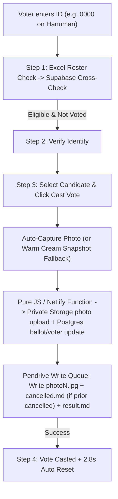

# Dual Storage Architecture — Supabase Cloud + Local Pendrive Backup

**Project:** School House Elections 2026 (`https://rziptxcknaeuorekxwrl.supabase.co`)  
**Status:** Pure Static JS + Netlify Functions Hidden-Key Proxy Implemented · House KPI Drill-Down & Pendrive (`cancelled.md` + `result.md`) Active  
**Companion Docs:** [PROJECT_PLAN.md](./PROJECT_PLAN.md) · [SESSION_1_LOG.md](./SESSION_1_LOG.md)

---

## 1. Design Goals

Every house polling booth runs independently as pure static HTML/CSS/JS (Netlify or static Live Server) and guarantees **zero vote loss**, **no keys open in tracked code**, **strict house isolation**, and **immediate visual health status**:

1. **Pure Static JS + Hidden-Key Support:** Zero keys appear inside tracked `.html`/`.js` files. When deployed to Netlify (`netlify/functions/supabase.mjs`), `SUPABASE_URL` and `SUPABASE_KEY` live strictly inside **Netlify Environment Variables** on the server. When testing on static Live Server (`127.0.0.1:5500`), browser JS connects using your **Publishable (`sb_publishable_` / `anon`) key** stored only in gitignored `supabase.local.json` or the Admin setup modal (`sb_secret_` keys are explicitly blocked from browser storage).
2. **House-Only USB Isolation:** Connecting a pendrive in Hanuman House (`hanuman/index.html` or `admin/house.html?house=hanuman`) writes **only Hanuman** voter folders (`photo.jpg`, `photo2.jpg`, `cancelled.md`, `result.md`) and `<HOUSE>_SUMMARY.md`.
3. **Resilient Fail-Safe:**
   - If the pendrive is bumped/unplugged, the Supabase/local ballot still completes safely and the top-right **Local Storage** indicator immediately switches from Green (`● Local Storage`) back to Red (`● Local Storage | Select`).
   - Before Supabase is connected, booths and Admin fall back cleanly to browser local store (`election_spr_2026_store_v5`) without losing UI state or blocking pendrive backups.

---

## 2. Dual-Write Flow



---

## 3. Supabase Cloud Design (`supabase/schema.sql`)

### 3.1 PostgreSQL Tables & Private Storage Bucket

| Resource | Primary Key / Path | Fields Stored | Security & Integrity |
| :--- | :--- | :--- | :--- |
| `public.voters` | `admission_no` (`text`) | `admission_no`, `full_name`, `class_name`, `section`, `house_code`, `house_name`, `final_status` (`Not Voted` \| `Voted` \| `Cancelled`), `voted_for`, `candidate_id`, `position_name`, `ballot_id`, `cast_at`, `cancelled_at`, `active_photo_field`, `photo_path`, `photos_history`, `is_active` | RLS enabled + `CHECK` constraints on `house_code` & `final_status` |
| `public.candidates` | `id` (`text`) | `id`, `admission_no`, `full_name`, `class_name`, `section`, `house_code`, `house_name`, `position_id`, `position_name`, `tagline`, `is_approved` | Indexed on `(house_code, is_approved)` + RLS enabled |
| `public.ballots` | `id` (`text`) | `id`, `election_id`, `admission_no`, `house_code`, `candidate_id`, `candidate_name`, `position_name`, `photo_field`, `photo_path`, `status` (`accepted` \| `cancelled`), `cast_at`, `cancelled_at`, `cancel_reason`, `cancelled_by` | Partial UNIQUE index `(admission_no) WHERE status = 'accepted'` prevents double voting at DB level |
| `public.audit_logs` | `id` (`text`) | `id`, `action`, `ballot_id`, `admission_no`, `student_name`, `house_code`, `reason`, `actor`, `created_at` | Append-only (`SELECT`, `INSERT` only) |
| `public.elections_overview` | View (`security_invoker = true`) | `"Admission No."`, `"Name"`, `"Class"`, `"Section"`, `"House"`, `"Vote"`, `"Photo"`, `"Final"`, `ballot_id`, `cast_at`, `cancelled_at` | Clean inspection view matching student roster columns |
| `storage.buckets` (`voter-photos`) | `<house_slug>/<admission_no>/photo[N].jpg` | Verification JPEG binaries (`public = false`) | Signed URLs (or Netlify photo endpoint); preserves `photo.jpg`, `photo2.jpg`, ... on retakes |

### 3.2 Verification & Photo Flow (`Excel First -> Supabase Cross-Check`)
1. **Excel Validation:** Every entered Admission No. is verified against the `871`-student roster parsed from `ELECTIONS HOUSES (1).xlsx` (including Hanuman `0000` Demo User), rejecting missing IDs and cross-house attempts.
2. **Supabase Cross-Check:** Booths check `public.voters` and `public.ballots` in Postgres directly via Supabase REST (or Netlify Function proxy) to block already-`"Voted"` voters (`409` guard) while allowing `"Cancelled"` re-votes with sequential `photo2.jpg`, `photo3.jpg`, ... uploads to `voter-photos`.
3. **One-Time Setup:**
   - Run [supabase/schema.sql](../supabase/schema.sql) once in **Supabase Dashboard → SQL Editor**.
   - On **Netlify:** set `SUPABASE_URL` and `SUPABASE_KEY` in Site Environment Variables (never in code).
   - Or for **Static Live Server (`127.0.0.1:5500`):** add your **Publishable (`sb_publishable_` / `anon`) key** into gitignored `supabase.local.json` or paste it inside Admin → **Sync Roster to Supabase** to upload all `871` students + `18` candidates.

---

## 4. Local Pendrive Storage Design (File System Access API)

### 4.1 Per-Device Handle Isolation
- Browser API: `window.showDirectoryPicker({ id, mode: "readwrite" })` (requires Chrome or Edge over `http://localhost` / `127.0.0.1` / `https://`).
- Directory handles are stored in IndexedDB (`election_spr_2026_pendrive_v1` → store `handles`) keyed strictly by scope:
  - Booth & House Admin scopes: `house_bhishma`, `house_gurudrona`, `house_hanuman`, `house_karna`, `house_vasistha`, `house_vishwamithra`
  - Overview / Root Admin scope: `overview`
- **UI States:**
  - Disconnected / permission needed on fresh browser launch: `● Local Storage` (Red dot) + `Select` button.
  - Selected & writable: `● Local Storage` (Green dot only — `Select` hides automatically).

### 4.2 USB Pendrive Directory Layout (Single House Booth)

When a voter checks in and casts a vote inside e.g. Hanuman House (`0000` Demo User):

```text
<Selected Pendrive Folder>/
├── HANUMAN_SUMMARY.md              # House-only live count, candidate tally & voter folder index
└── 0000_Demo_User/                 # Created on Step 2 Verify ID -> finalized on Step 3 Cast Vote
    ├── photo.jpg                   # Attempt 1 JPEG verification image (never overwritten)
    ├── photo2.jpg                  # Attempt 2 image if Attempt 1 was cancelled / prior photo existed (photo3.jpg, ...)
    ├── cancelled.md                # Written whenever a prior vote was cancelled (lists cancelled attempts & photo.jpg)
    └── result.md                   # Written for active Accepted vote (Student Info -> Vote Details with current photo2.jpg)
```

*(If selected on [index.html](../index.html) or [admin/index.html](../admin/index.html), those same structures are automatically grouped cleanly into `<house>/` subfolders: `bhishma/`, `gurudrona/`, `hanuman/`, `karna/`, `vasistha/`, `vishwamithra/`.)*

### 4.3 Reliability Safeguards
- **Serialized Async Write Queue (`writeQueue`):** All `.md` and `.jpg` file writes execute sequentially so rapid votes never trigger `NoModificationAllowedError` locks on FAT32/exFAT pendrives.
- **Incomplete Step-2 Cleanup:** If a student verifies their ID (`markVoterStarted`) and clicks **Back** before voting, `clearIncompleteStarted()` removes only the temporary unvoted folder we just created; completed votes clear `activeStartedFolder` immediately so the `2.8s` auto-reset timer never touches finished folders.
- **No Roster Freezing in `localStorage`:** `election_spr_2026_store_v5` stores only `voterStatus`, `ballots`, and `auditLogs` locally, always reading active student/candidate lists from live `ADMIN_DATA` / `HOUSE_DATA` or Supabase Postgres.

### 4.4 Four Leadership Roles & Shared Batch Photos
- Every voter casts 4 role ballots per submission (`CAPTAIN_BOY` -> `vote_10_boy`, `CAPTAIN_GIRL` -> `vote_10_girl`, `VICE_CAPTAIN_BOY` -> `vote_9_boy`, `VICE_CAPTAIN_GIRL` -> `vote_9_girl`), stored in `public.voters` + per-role `public.ballots` rows (`position_id`).
- All 4 role ballots submitted together share one verification photo (`photo.jpg`), while cancelling a specific role writes it to `cancelled.md`, clears only that role's `vote_*` column, and keeps the remaining roles accepted until the student re-votes that role (`photo2.jpg`).

